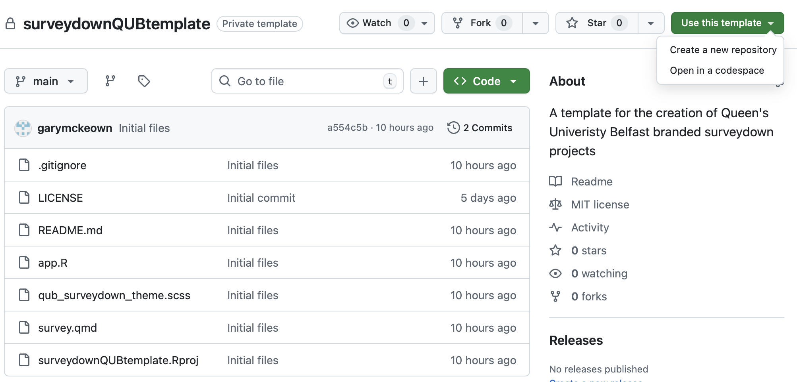
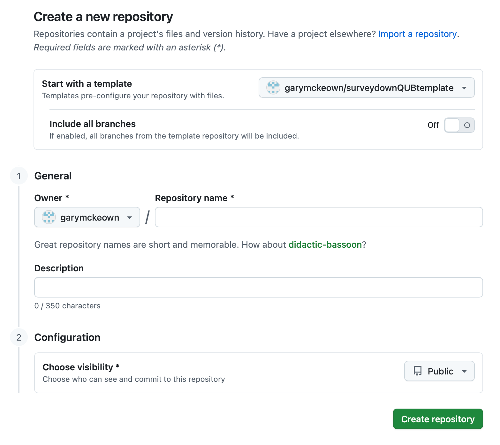
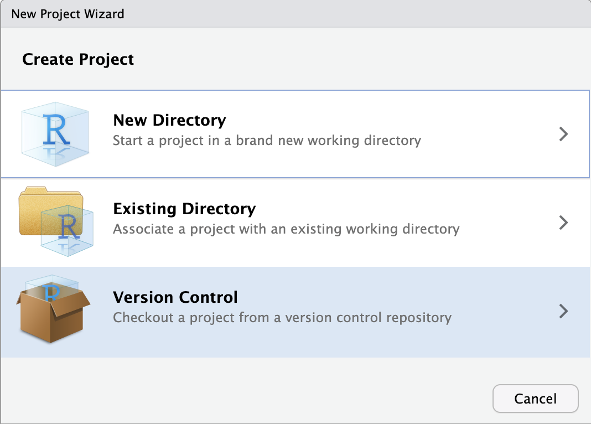
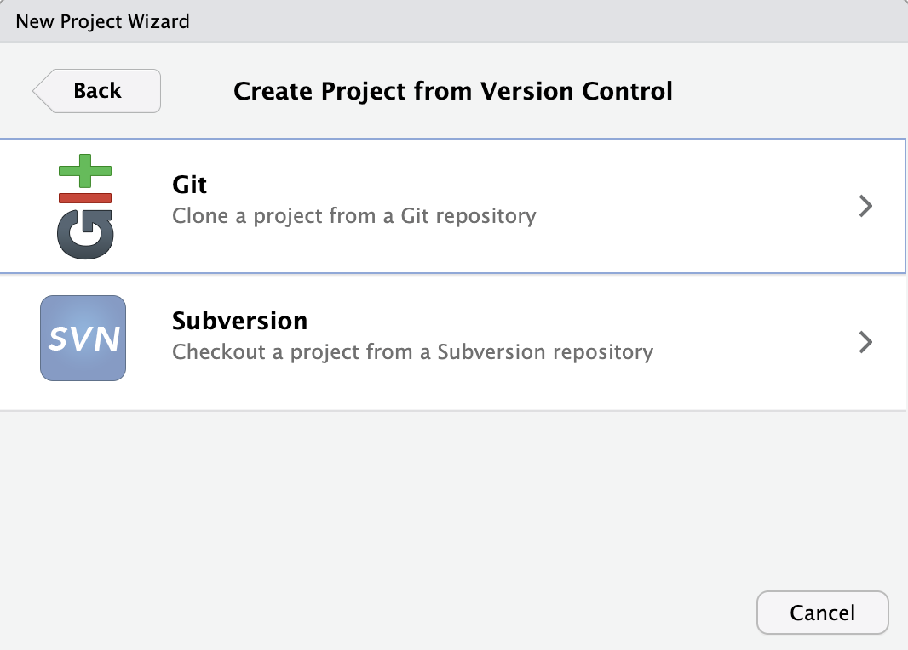
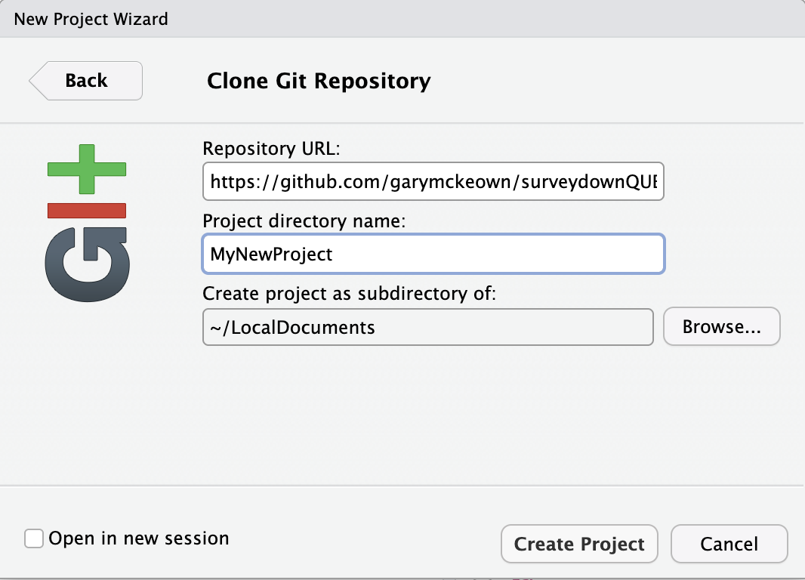

# Queen's University Belfast surveydown Template

This is a minimal template for the [surveydown](https://www.surveydown.org) R package to allow the creation of surveys and online experiments that are based on Queen's University Belfast branding and requirements.

To use this template you can either download it to create a local copy and use it as a basic RStudio project. Alternatively you can use it to create your own GitHub repository. This project has been set up as a template repository, meaning that it can be used to create new GitHub repositories. Create a new repository by clicking on the green "Use this template" dropdown button and selecting "Create a new repository" as shown in Figure 1.

{#UseThisTemplateDropdownButton width="600"}

Then fill in the appropriate details as shown in Figure 2.

{#CreateANewRepositoryDialogBox width="500"}

This creates a GitHub repository with the appropriate files from the template. To create a local copy using RStudio. Open a new project using the "New Project..." option in the File menu. That will open a dialogue box like that shown in Figure 3. Choose Version Control. Then choose Git (See Figure 4.).

{#CreateProjectDialogueBox width="400"}

{#CreateProjectFromVersionControlDialogueBox width="400"}

This will open the final dialogue box as shown in Figure 5.

{#CloneGitRepositoryDialogueBox width="400"}

Add the repository URL:

<https://github.com/garymckeown/surveydownQUBtemplate.git>

Add your chosen project directory name, and browse to the file directory location that you would your new local copy of the project to be stored in and click Create Project.

------------------------------------------------------------------------

The template includes a Participant Information Sheet and Consent form template that are provided as exemplars by the [Faculty of Engineering and Physical Sciences Research Ethics Committee](https://www.qub.ac.uk/Research/Governance-ethics-and-integrity/Ethics/FacultyResearchEthicsCommittees/) (EPS REC).

The Participant Information Sheet needs to be adjusted to suit the needs of the current study.

Some of the questions on the consent form have been commented out, but have been left in the document should people choose to use them the comments should be removed and adjustments should be made as necessary.

Two demographic questions have been added in an "About You" page, these ask for age using a numeric question and ask for gender using the preferred question structure as recommended by the EPS REC.

There are metadata variables included in the yml of the survey.qmd file these are currently

-   version: 1

-   date: "27/10/2025"

-   chief_investigator: "Gary McKeown"

-   project_title: "Our Project Title"

-   study_number: "EPS 25_170"

These can be populated as desired by the research team and they will automatically populate in the Participant Information Sheet and the Consent form. They can be added to any page of the document using the shortcode:



The idea here is to place the once in the yml to avoid human error from having to correct this multiple times in the file.

To use the metadata variables within questions see how it has been done in the first in the first question in the consent form use the R paste0() function.

You should also change the ReadMe.md file and delete the relevant ReadMe images to keep your new repository nice and clean.
